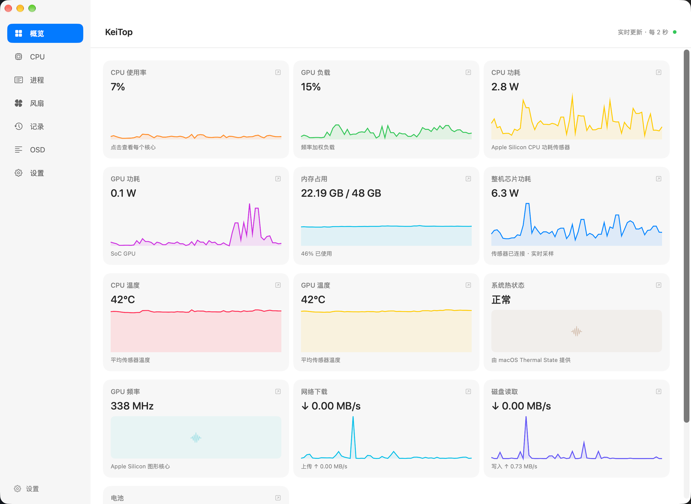
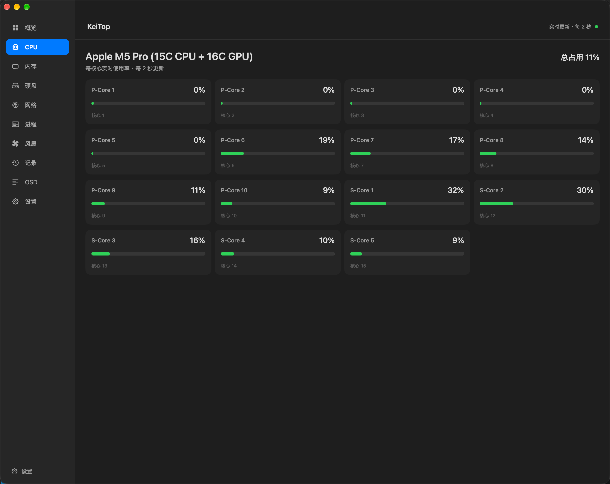
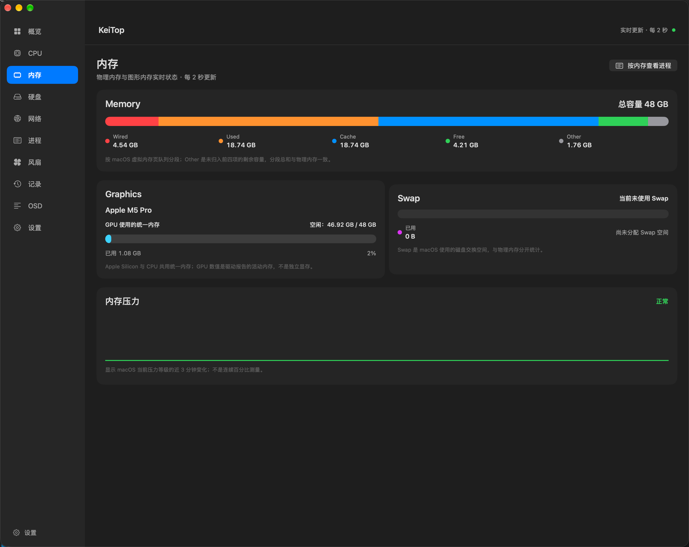
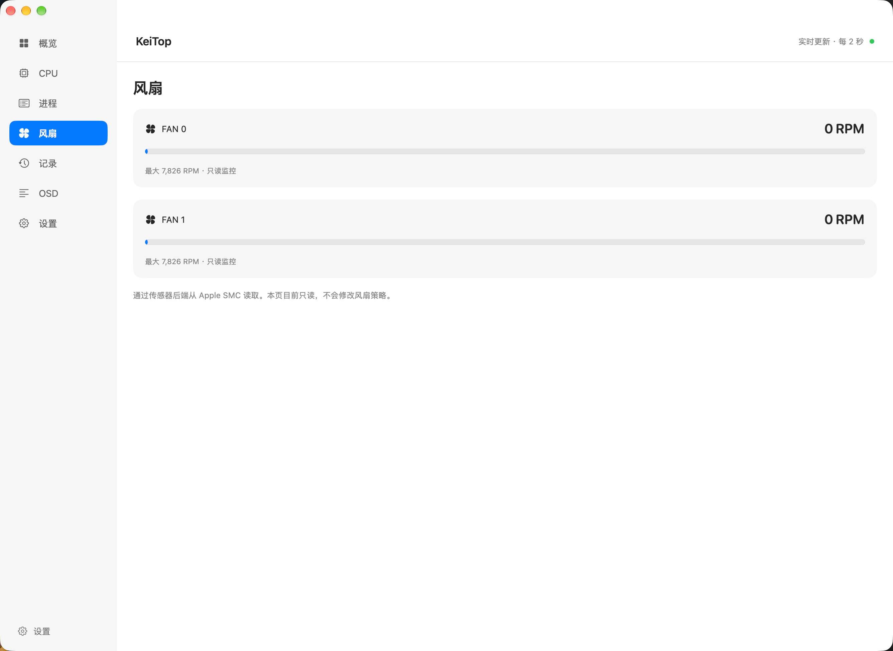
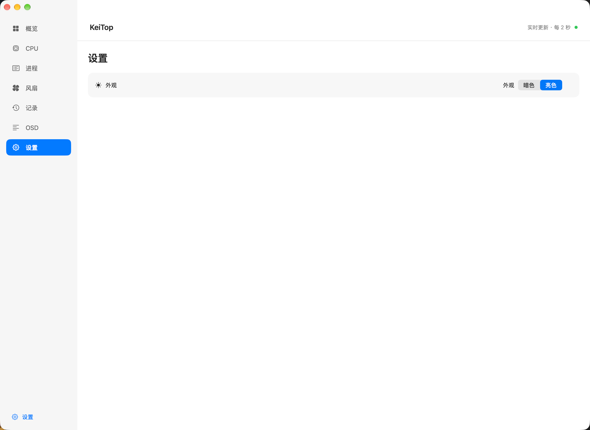
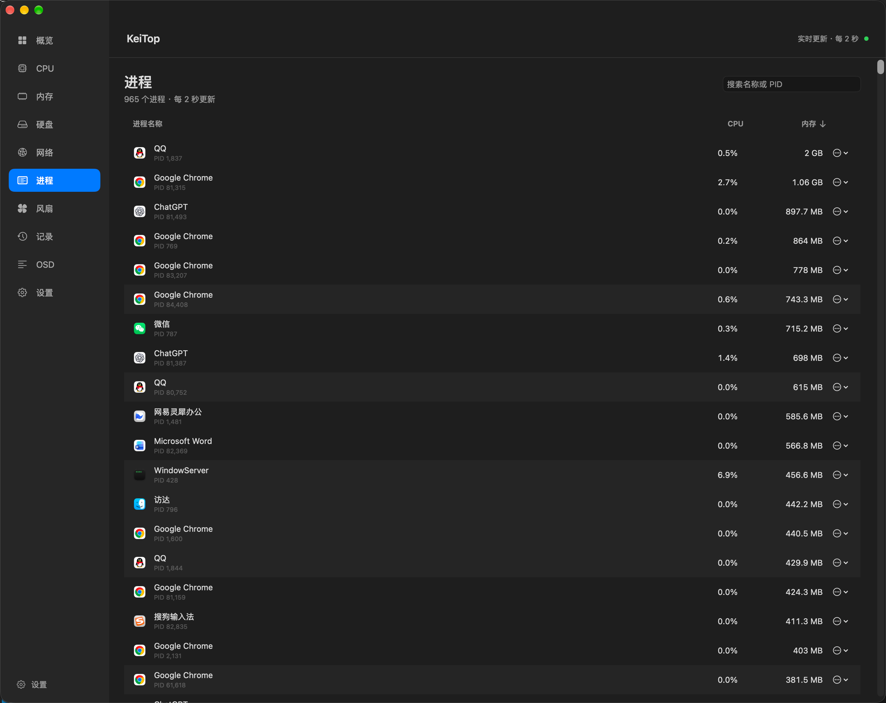
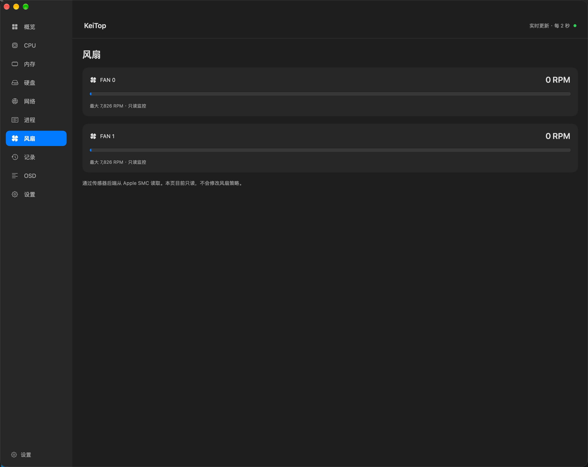

# keitop

**Version 0.2.0** · Native macOS system monitor built with SwiftUI and Swift Charts. Requires macOS 14 or later.


## Features

- Overview cards for CPU and GPU load, power, temperatures, memory, network throughput, disk read/write throughput, storage capacity, and battery charge; the overview grid adapts to window width
- Per-core CPU usage and chip specification with CPU/GPU core counts
- Dedicated memory page with a Wired/Used/Cache/Free/Other composition bar, swap, memory-pressure history, and GPU memory usage
- Dedicated disk page for system volume capacity, mounted network volumes, and removable drives
- Dedicated network page for active interfaces, local IP addresses, the default gateway, and live traffic; public IP lookup is manual and uses ipify.org
- Process list with full application names and icons, name/PID search, and ascending/descending CPU or memory sorting
- Process termination with a confirmation step: send `SIGTERM` first, then ask again before sending `SIGKILL` if the process is still running after three seconds
- Process termination is limited to processes owned by the current user; keitop and selected system processes are protected
- Fan speed display, saved metric snapshots, and a movable OSD window
- Dark and light appearance modes

## Sensor backend

keitop reads Apple Silicon sensor data from `mactop` in headless JSON mode. It can fall back to `macmon`. Install either tool with Homebrew:

```sh
brew install mactop
```

or:

```sh
brew install macmon
```

The app does not write to the SMC or change fan settings. Some sensor readings depend on undocumented hardware interfaces and may vary by Mac model or macOS version. If no sensor backend is available, CPU load, memory, and macOS thermal state remain available while unsupported sensor values are shown as unavailable.

The memory page reads physical memory and swap from macOS, and uses the kernel memory-pressure level when available. GPU memory comes from IOAccelerator driver statistics; Apple Silicon reports GPU activity as a portion of unified system memory rather than dedicated VRAM. These optional counters may be unavailable on some GPUs or macOS versions.

## What's new in 0.2.0

- Added network and disk detail pages, including active interfaces, local addresses, default gateway, storage capacity, and mounted network volumes
- Added an on-demand public IP lookup. It contacts ipify.org only when requested
- Added a segmented physical memory breakdown and GPU unified-memory details
- Added process icons, sorting, and guarded process termination
- Improved the overview layout and added capacity and battery indicators

## Build

Open `MacStatus.xcodeproj` in Xcode and choose the `keitop` scheme, or build from Terminal:

```sh
xcodebuild -project MacStatus.xcodeproj -scheme keitop -configuration Release build
```

The Swift package can also be built with:

```sh
swift build
```

## Release

The Xcode project produces a universal macOS app for Apple Silicon and Intel. Release signing, notarization, and distribution are not configured in this source repository.

## License

The source code is distributed under the MIT License. The illustration bundled in `Assets.xcassets/AppIcon.appiconset` is excluded from that license and remains the property of its respective rights holder.

## UI Preview








